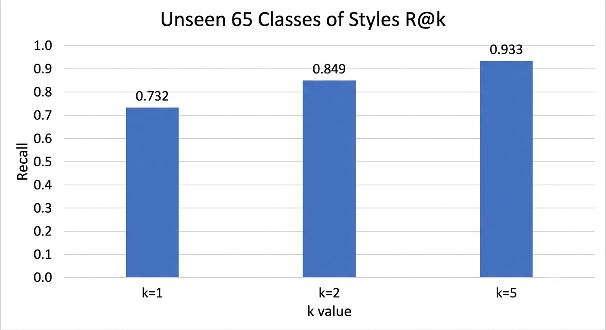

# Anime Style Art Embedding

A style embedding model for anime-style artwork.

This project provides a model that extracts style-related embeddings from anime-style artwork and helps identify visually similar images in a dataset.

> **Note:** This model offers modest performance and is intended as a lightweight tool for filtering similar images, rather than a highly accurate style recognition system.

## Model Performance



The metric above measures how effectively the median embedding of each style class retrieves images belonging to that class.

## Installation

### 1. Create a Conda Environment

```bash
conda create -n ani-style python=3.13
conda activate ani-style
```

### 2. Install PyTorch

Install [PyTorch](https://pytorch.org/) according to your environment and hardware configuration.

This project was developed using `torch==2.7.1`.

### 3. Install Dependencies

```bash
python -m pip install -r requirements.txt
```

## Usage

### Inference: Search for Similar Artwork

You can use this model to find images with styles similar to a set of reference images in your dataset.

#### Step 1: Prepare Reference Images

Create a folder containing reference images that represent the art style you want to find.

- Use images that share the same target art style.
- Using multiple reference images with different visual characteristics is generally recommended.
- Be mindful of subject and composition bias. Variations in the number of subjects, full-body shots, upper-body shots, and wide shots may negatively affect retrieval performance.

#### Step 2: Prepare Your Dataset

Create a dataset folder containing the images you want to search.

#### Step 3: Configure the Search

Open `config/search_config.toml` and configure the following paths:

- `ref_path`: Path to the folder containing your reference images.
- `data_path`: Path to the dataset you want to search.

#### Step 4: Run the Search

Run the following command:

```bash
python mysrc/search_similar_art.py --config="config/search_config.toml"
```

The matching images will be saved to the configured output directory. By default, the output directory is `similares`.

## Configuration

The following arguments are used by `search_similar_art.py`.

| Argument | Description |
| --- | --- |
| `ref_path` | Path to the folder containing reference images. Use images that share the target art style. A diverse set of references is recommended. |
| `data_path` | Path to the dataset to search. |
| `output_path` | Directory where matching images are copied or moved. The results are also saved as a Parquet file in this directory. |
| `transform` | Image preprocessing method used before inference. See the options below. |
| `result_path` | Path to an existing Parquet results file. When provided, image inference on `data_path` can be skipped. Keep `how` set to `'copy'` when using this option. If the images in `data_path` have changed, the existing results may no longer be valid. |
| `threshold` | Similarity threshold used to filter images. Higher values generally result in stricter filtering. A value between `0.5` and `0.7` is recommended as a starting point. |
| `how` | Specifies how matching images are handled. |
| `save_result` | Whether to save the results as a Parquet file. |
| `sfg` | Whether to save style feature class information alongside the results. |
| `sfg_threshold` | Threshold used for style feature tagging. |
| `center` | Method used to calculate the center embedding of the reference images. The median is generally recommended. |
| `precision` | Precision used for model inference. |
| `input_dtype` | Data type used for input images. |

### Image Preprocessing Options

The `transform` argument supports the following options:

- `simple_center_crop`: Resizes the shorter side of the image to the model's input size, then crops the center.
- `long_max_pad_valid`: Resizes the longer side of the image to the model's input size, then pads the shorter side.

### Limitations and Recommendations

- **Reference image selection matters.** Use multiple images that represent the same target style.
- **Composition and subject bias may occur.** The model may learn to associate certain visual patterns with a style, including the number of subjects, full-body shots, upper-body shots, and wide shots.
- **Results should be reviewed.** This model is intended to assist with filtering similar artwork, so some false positives and false negatives should be expected.

## References

- [OpenCLIP](https://github.com/mlfoundations/open_clip)
- [EVA-02](https://arxiv.org/abs/2303.11331)